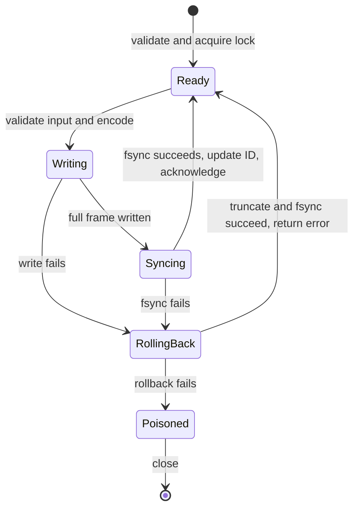

# Format and architecture

Version 1 uses explicit little-endian serialization; no C++ struct layout is written to disk. Signed integers are encoded as 64-bit two's-complement bit patterns. Checksums use CRC-32/ISO-HDLC, compatible with `zlib.crc32` (reflected polynomial `0xEDB88320`, initial/final XOR `0xFFFFFFFF`).

## File header: 16 bytes

| Offset | Size | Field |
| --- | --- | --- |
| 0 | 8 | ASCII `EVTLOG01` |
| 8 | 4 | Format version, unsigned integer 1 |
| 12 | 4 | CRC32 over bytes 0–11 |

## Record frame header: 16 bytes

| Offset | Size | Field |
| --- | --- | --- |
| 0 | 4 | ASCII `EVT1` |
| 4 | 4 | Body length |
| 8 | 4 | CRC32 over the entire body |
| 12 | 4 | CRC32 over header bytes 0–11 |

The separate header checksum prevents an accidentally corrupted length from being treated as a valid truncated body. Body length must be between 32 and 1,048,672 bytes before allocation.

## Record body: 32 bytes plus text

| Offset | Size | Field |
| --- | --- | --- |
| 0 | 8 | Unsigned event ID |
| 8 | 8 | Signed timestamp |
| 16 | 4 | Category byte length |
| 20 | 4 | Payload byte length |
| 24 | 8 | Signed value |
| 32 | category length | Category, valid UTF-8 |
| following | payload length | Payload, valid UTF-8 |

Both text lengths must exactly consume the body; category is nonempty. IDs must begin at 1 and advance by exactly 1. No index or separate commit marker exists. A complete valid frame is retained on recovery whether or not a caller received its acknowledgment.

## Write state transitions

Memory allocation, validation and encoding happen before disk mutation. Append uses `pwrite` with EINTR/short-write handling; the file is not opened with `O_APPEND`. In-memory end/ID advance only after file sync succeeds. The lifetime lock and object mutex protect these offsets from cooperating writers.

## Recovery boundaries

Open scans records in order before any truncation. If a complete frame anywhere in that scan is corrupt, construction fails without truncating. Only an incomplete suffix is recoverable. Complete CRC mismatches at EOF are errors as well: truncating them could silently erase an acknowledged event. A successful recovery syncs the truncation before returning. Recovery itself can fail, and callers must check its result.

These rules assume regular local-file append interruption. They cannot distinguish an incomplete tail from later external truncation or arbitrary disk damage. They do not repair corruption, provide authentication, or prevent a noncooperating process from bypassing advisory locks.

## Components

| Component | Responsibility |
| --- | --- |
| `include/eventstore.hpp` | Typed public events, query and store API |
| `src/eventstore.cpp` | Encoding/CRC/validation, POSIX locking and durability, streaming scan |
| `src/main.cpp` | Bounded TSV input, strict integer parsing, CLI JSONL |
| `tests/test_cli.py` | Real files, independent format fixtures, subprocess failure behavior |
| `tests/library_tests.cpp` | Library limits, threads, locks and write rollback |
| `tests/faultio.c` | Linux test-only syscall failure interposer |
| `bench/query_bench.cpp` | In-process C++ query timing |
| `bench/compare.py` | Dataset generation, SQLite comparison and equality checks |
